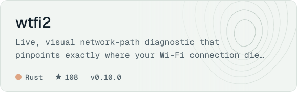
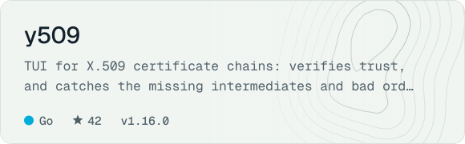
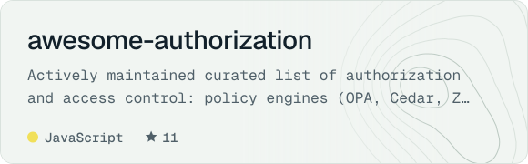
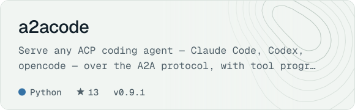
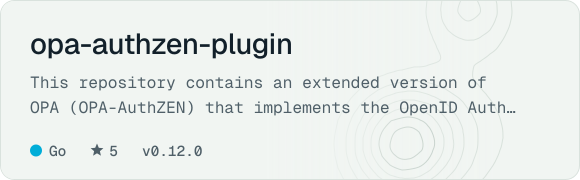
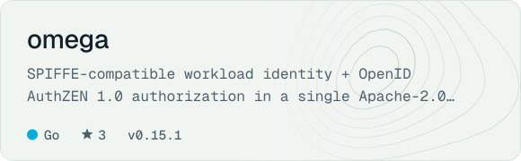
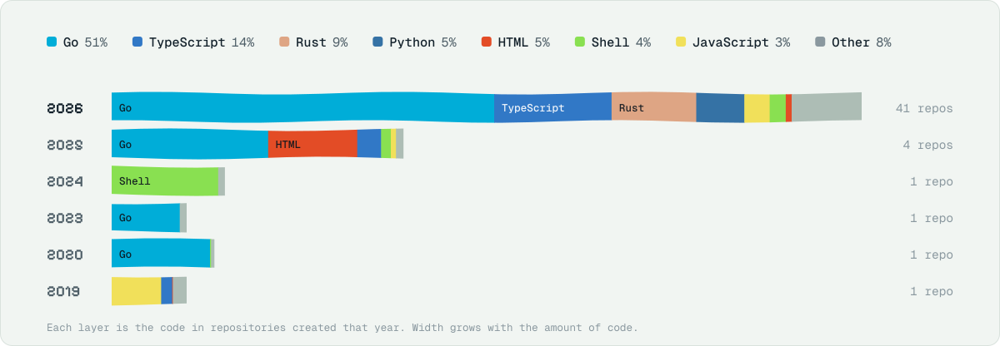
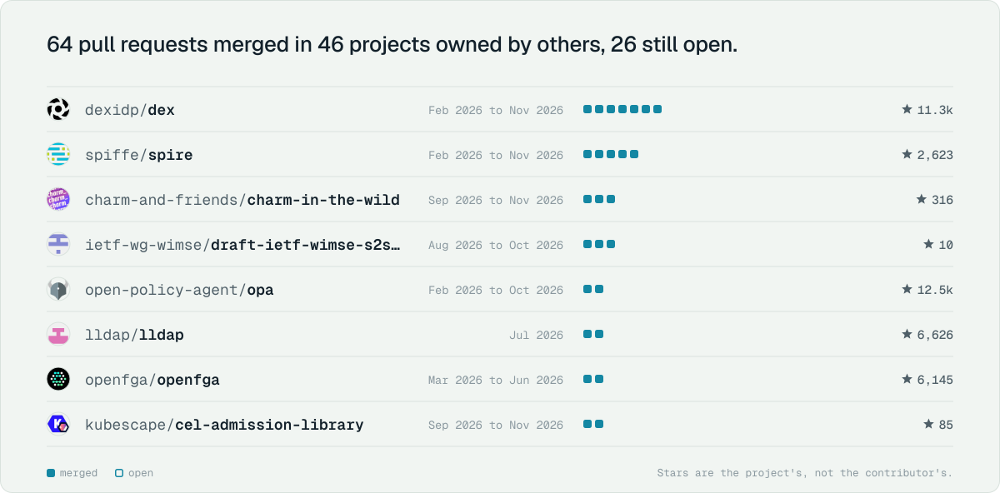

<!-- gitsona:start -->

<picture>
  <source media="(prefers-color-scheme: dark)" srcset="./gitsona/hero-dark.svg">
  
</picture>

Identity, authorization, and cloud native security. Go and Rust.

Lately: [gitsona](https://github.com/kanywst/gitsona), [awesome-authorization](https://github.com/kanywst/awesome-authorization), [i-watched-movies](https://github.com/kanywst/i-watched-movies).

[kanywst.github.io](https://kanywst.github.io/)

### Working style

<picture>
  <source media="(prefers-color-scheme: dark)" srcset="./gitsona/traits-dark.svg">
  
</picture>

### Rhythm

<picture>
  <source media="(prefers-color-scheme: dark)" srcset="./gitsona/rhythm-dark.svg">
  
</picture>

### Projects

[<picture><source media="(prefers-color-scheme: dark)" srcset="./gitsona/project-wtfi2-dark.svg"></picture>](https://github.com/kanywst/wtfi2)
[<picture><source media="(prefers-color-scheme: dark)" srcset="./gitsona/project-y509-dark.svg"></picture>](https://github.com/kanywst/y509)
[<picture><source media="(prefers-color-scheme: dark)" srcset="./gitsona/project-awesome-authorization-dark.svg"></picture>](https://github.com/kanywst/awesome-authorization)
[<picture><source media="(prefers-color-scheme: dark)" srcset="./gitsona/project-a2acode-dark.svg"></picture>](https://github.com/kanywst/a2acode)
[<picture><source media="(prefers-color-scheme: dark)" srcset="./gitsona/project-opa-authzen-plugin-dark.svg"></picture>](https://github.com/kanywst/opa-authzen-plugin)
[<picture><source media="(prefers-color-scheme: dark)" srcset="./gitsona/project-omega-dark.svg"></picture>](https://github.com/kanywst/omega)

### Languages over time

<picture>
  <source media="(prefers-color-scheme: dark)" srcset="./gitsona/strata-dark.svg">
  
</picture>

### Upstream

<picture>
  <source media="(prefers-color-scheme: dark)" srcset="./gitsona/upstream-dark.svg">
  
</picture>

Recently merged:

- [Add \`k8s\_clustertrustbundle\` BundlePublisher plugin](https://github.com/spiffe/spire/pull/7411) in `spiffe/spire`, 15 Nov 2026
- [fix(server/grants): check requested\_token\_type before calling the connector in token exchange](https://github.com/dexidp/dex/pull/5149) in `dexidp/dex`, 12 Nov 2026
- [fix(server): use invalid\_request for an unsupported subject\_token\_type and reject any typ other than JWT](https://github.com/dexidp/dex/pull/5150) in `dexidp/dex`, 12 Nov 2026
- [fix(C-0001): match untrusted registries case-insensitively](https://github.com/kubescape/cel-admission-library/pull/176) in `kubescape/cel-admission-library`, 12 Nov 2026
- [Limit the size of bundle endpoint and trust bundle URL responses](https://github.com/spiffe/spire/pull/7383) in `spiffe/spire`, 12 Nov 2026

Drawn by [gitsona](https://github.com/kanywst/gitsona) from public GitHub activity on 15 Nov 2026.

<!-- gitsona:end -->
