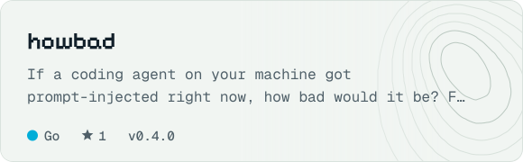
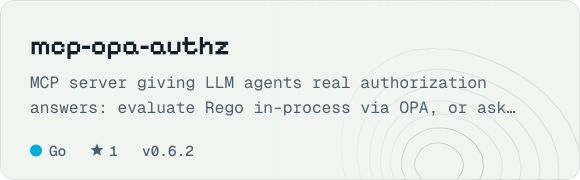
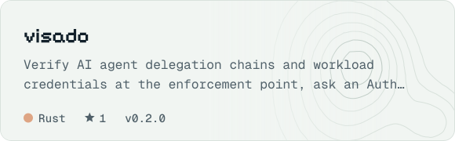

<!-- gitsona:start -->

<picture>
  <source media="(prefers-color-scheme: dark)" srcset="./gitsona/hero-dark.svg">
  
</picture>

Identity, authorization, and cloud native security. Go and Rust.

Lately: [dotfiles](https://github.com/kanywst/dotfiles), [visado](https://github.com/kanywst/visado), [gitsona](https://github.com/kanywst/gitsona).

[kanywst.github.io](https://kanywst.github.io/)

### Working style

<picture>
  <source media="(prefers-color-scheme: dark)" srcset="./gitsona/traits-dark.svg">
  
</picture>

### Rhythm

<picture>
  <source media="(prefers-color-scheme: dark)" srcset="./gitsona/rhythm-dark.svg">
  
</picture>

### Projects

[<picture><source media="(prefers-color-scheme: dark)" srcset="./gitsona/project-hammurabi-dark.svg"></picture>](https://github.com/kanywst/hammurabi)
[<picture><source media="(prefers-color-scheme: dark)" srcset="./gitsona/project-wimsey-dark.svg"></picture>](https://github.com/kanywst/wimsey)
[<picture><source media="(prefers-color-scheme: dark)" srcset="./gitsona/project-howbad-dark.svg"></picture>](https://github.com/kanywst/howbad)
[<picture><source media="(prefers-color-scheme: dark)" srcset="./gitsona/project-mcp-opa-authz-dark.svg"></picture>](https://github.com/kanywst/mcp-opa-authz)
[<picture><source media="(prefers-color-scheme: dark)" srcset="./gitsona/project-visado-dark.svg"></picture>](https://github.com/kanywst/visado)
[<picture><source media="(prefers-color-scheme: dark)" srcset="./gitsona/project-brtc-dark.svg"></picture>](https://github.com/kanywst/brtc)

### Languages over time

<picture>
  <source media="(prefers-color-scheme: dark)" srcset="./gitsona/strata-dark.svg">
  
</picture>

### Upstream

<picture>
  <source media="(prefers-color-scheme: dark)" srcset="./gitsona/upstream-dark.svg">
  
</picture>

Recently merged:

- [y509: init at 1.15.0](https://github.com/NixOS/nixpkgs/pull/559182) in `NixOS/nixpkgs`, 18 Nov 2026
- [fix(C-0001): match untrusted and public registries case-insensitively](https://github.com/kubescape/regolibrary/pull/944) in `kubescape/regolibrary`, 18 Nov 2026
- [fix(server): reject JSON-RPC member names that differ from the defined ones only by case](https://github.com/mark3labs/mcp-go/pull/1166) in `mark3labs/mcp-go`, 18 Nov 2026
- [Add a2acode to Clients & Remote Access](https://github.com/nMaroulis/awesome-agent-client-protocol/pull/12) in `nMaroulis/awesome-agent-client-protocol`, 15 Nov 2026
- [Add \`k8s\_clustertrustbundle\` BundlePublisher plugin](https://github.com/spiffe/spire/pull/7411) in `spiffe/spire`, 15 Nov 2026

Drawn by [gitsona](https://github.com/kanywst/gitsona) from public GitHub activity on 19 Nov 2026.

<!-- gitsona:end -->
